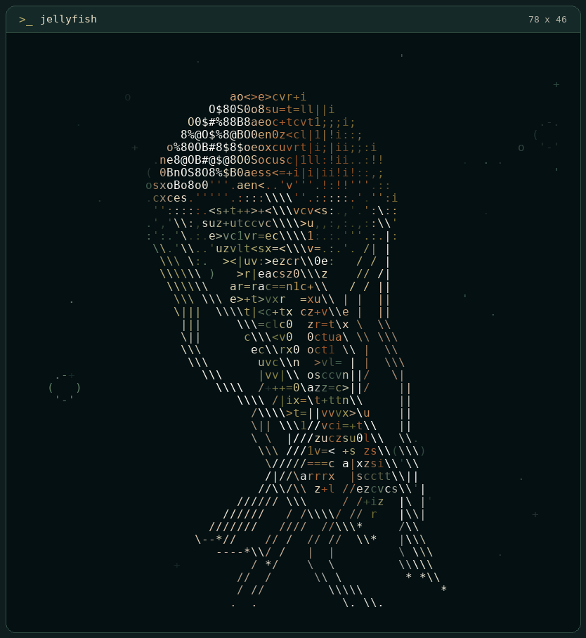

<h1 align="center">Jellyfish</h1>
<p align="center">A fullscreen 3D ASCII jellyfish for macOS and Linux terminals.</p>

<p align="center">
  
</p>

Copper, old gold, olive, and celadon spiral around the bell and down the tentacles as bubbles drift past. The animation scales with your window and uses your terminal profile’s background, including its transparency.

## Quick start

Open the repository folder in an interactive terminal, including VS Code’s integrated terminal. Jellyfish uses **Python 3.8+** and the standard library.

```sh
python3 jellyfish-3d.py
```

Press **`q`** or **`Ctrl+C`** to quit. Run `NO_COLOR=1 python3 jellyfish-3d.py` for monochrome.

## Install the `jellyfish` command

From the repository folder, run these commands to install and launch it.

```sh
mkdir -p "$HOME/.local/bin" &&
  install -m 755 jellyfish-3d.py "$HOME/.local/bin/jellyfish" &&
  export PATH="$HOME/.local/bin:$PATH" &&
  jellyfish
```

Add the `export PATH` line to your shell’s startup file, such as `~/.zshrc` on macOS, to run `jellyfish` in future terminal sessions.

## How it works

The renderer intersects view rays with a tilted ellipsoid for the bell and samples 3D curves for the tentacles. A depth buffer decides which glyph appears in each cell. The palette shifts with both angle and distance along the jellyfish, sending color around the bell and along the strands.
